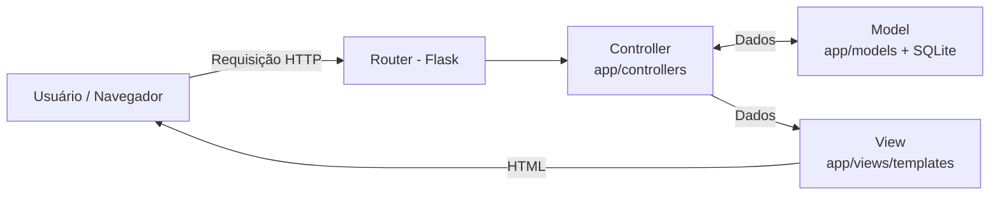

# 1. Escopo e Requisitos — Agenda Fácil

## 1.1 Visão geral
O **Agenda Fácil** é uma aplicação web para **agendamento de serviços** em pequenos
estabelecimentos (barbearias, salões, clínicas, estúdios). Ele substitui a agenda em papel
ou em mensagens de aplicativo por um controle centralizado de clientes, profissionais,
serviços e horários, **evitando conflitos de agenda** e informando os horários realmente livres.

**Problema:** agendamentos feitos manualmente geram sobreposição de horários, esquecimentos,
retrabalho e falta de histórico.

**Objetivo:** permitir cadastrar clientes, profissionais e serviços e marcar, consultar,
cancelar e concluir atendimentos, respeitando regras de negócio.

**Ciclo de melhoria contínua (Kaizen):** este escopo revisa o planejamento do PITE I. Os itens
da seção 1.6 registram o que foi ajustado nesta revisão.

## 1.2 Atores
| Ator | Descrição |
|------|-----------|
| Atendente/Gestor | Usa o sistema para cadastrar dados e gerenciar a agenda (único perfil nesta versão). |

## 1.3 Requisitos funcionais
| ID | Requisito |
|----|-----------|
| RF01 | Cadastrar, listar, buscar, editar e excluir **clientes** |
| RF02 | Cadastrar, listar, editar e excluir **serviços** (nome, descrição, duração, preço, ativo) |
| RF03 | Cadastrar, listar, editar e excluir **profissionais** e vincular os serviços que realizam |
| RF04 | Criar **agendamento** escolhendo cliente, serviço, profissional, data e horário |
| RF05 | Mostrar apenas **horários livres** para o profissional/serviço/data escolhidos |
| RF06 | **Cancelar** agendamento |
| RF07 | **Concluir** atendimento |
| RF08 | Listar agendamentos com filtros (data, profissional, situação) |
| RF09 | Exibir painel com indicadores e agenda do dia |

## 1.4 Regras de negócio
| ID | Regra |
|----|-------|
| RN01 | Não é permitido agendar em data/hora passada |
| RN02 | Atendimento deve ocorrer no horário de funcionamento (seg–sáb, 08:00–18:00) e terminar até o fechamento |
| RN03 | O profissional não pode ter dois agendamentos sobrepostos |
| RN04 | O cliente não pode ter dois agendamentos sobrepostos |
| RN05 | O profissional deve estar ativo e realizar o serviço escolhido |
| RN06 | O serviço escolhido deve estar ativo |
| RN07 | O horário de término é calculado: início + duração do serviço |
| RN08 | Só é possível cancelar/concluir agendamentos com situação "agendado" |
| RN09 | Só é possível concluir um atendimento que já começou |
| RN10 | E-mail de cliente é único; nome de serviço é único |
| RN11 | Cliente, profissional ou serviço com agendamentos não pode ser excluído (serviços e profissionais podem ser **inativados**) |

## 1.5 Requisitos não funcionais
| ID | Requisito | Como é atendido |
|----|-----------|-----------------|
| RNF01 | Usabilidade | Princípios de IHC (ver `03-ihc.md`) |
| RNF02 | Portabilidade | Aplicação web; roda em qualquer SO com Python 3.10+ |
| RNF03 | Manutenibilidade | Arquitetura MVC em camadas; código comentado |
| RNF04 | Confiabilidade | 38 testes automatizados; erros tratados com mensagens claras |
| RNF05 | Integridade de dados | Chaves estrangeiras, `CHECK`s e `UNIQUE` no banco |
| RNF06 | Responsividade | CSS adaptável a celular e desktop |
| RNF07 | Segurança básica | Consultas parametrizadas (contra SQL Injection); escape automático do Jinja2 (contra XSS) |

## 1.6 Revisão do planejamento (melhoria contínua)
- Escopo reduzido a um núcleo viável: **sem login e sem pagamentos** (vão para versões futuras).
- Inclusão da **relação N:N profissional × serviço**, para que só se ofereça ao cliente quem realmente faz o serviço.
- Inclusão de **RN04** (conflito do cliente) e **RN09** após análise de cenários de uso.
- Adoção de **inativação** em vez de exclusão para preservar o histórico.

## 1.7 Fora do escopo (versões futuras)
Login e perfis de acesso, envio de lembretes por e-mail/WhatsApp, pagamento online, relatórios financeiros, agendamento pelo próprio cliente.

## 1.8 Tecnologias
| Camada | Tecnologia |
|--------|-----------|
| Front-end (View) | HTML5, CSS3, JavaScript (fetch/JSON), templates Jinja2 |
| Back-end (Controller + Model) | Python 3 + Flask (padrão MVC) |
| Banco de dados | SQLite 3 (SQL padrão) |
| Testes | `unittest` (xUnit, equivalente ao JUnit/PHPUnit) |
| Versionamento | Git + GitHub |

## 1.9 Arquitetura MVC

| Camada | Pasta | Responsabilidade |
|--------|-------|------------------|
| Model | `app/models/` | Regras de negócio, validações e acesso ao banco |
| View | `app/views/templates/`, `app/static/` | Telas HTML, CSS e JavaScript |
| Controller | `app/controllers/` | Recebe requisições, chama o Model, escolhe a View |
