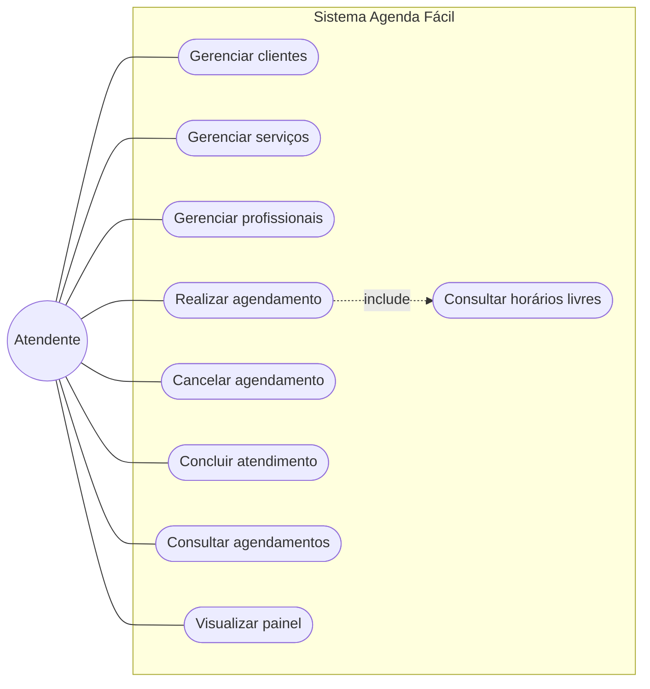
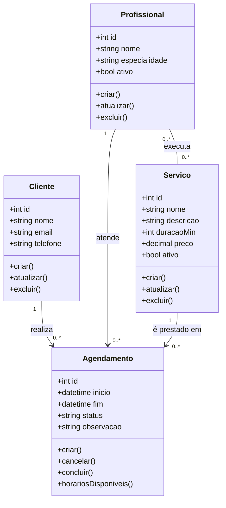
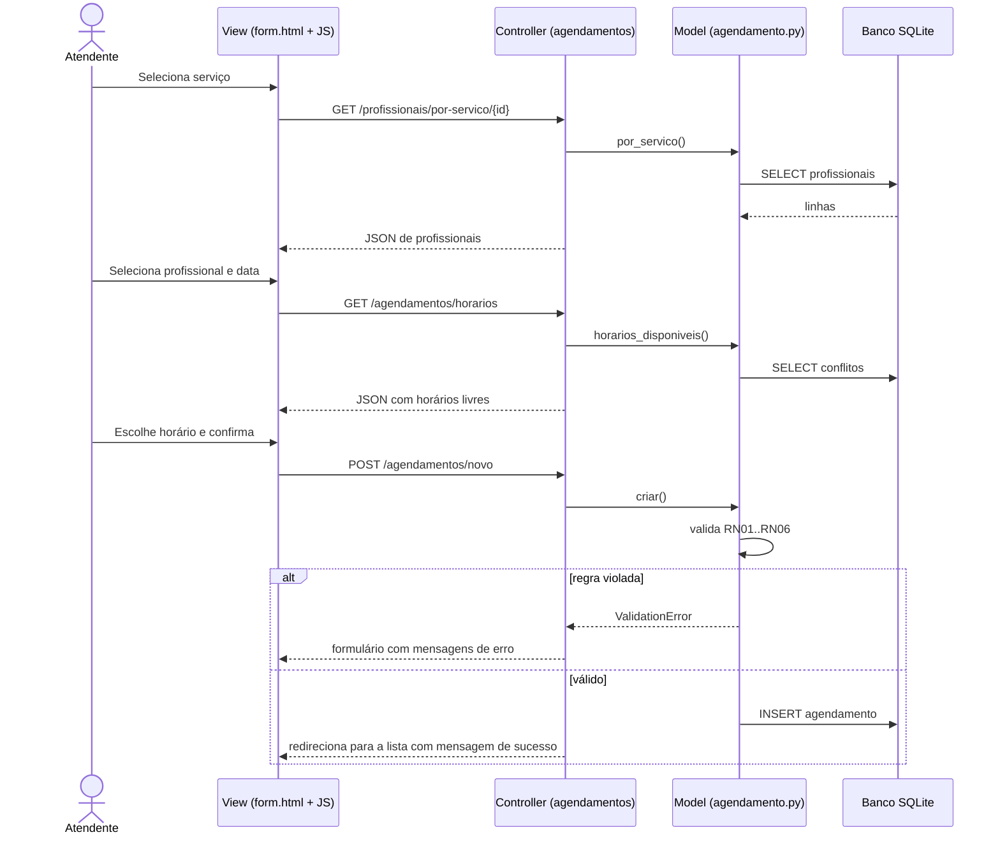
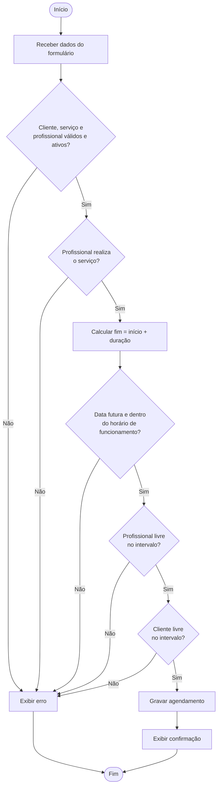
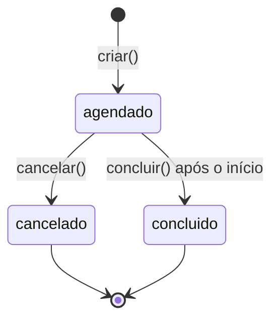

# 2. Modelagem UML

## 2.1 Diagrama de casos de uso

### Especificação do caso de uso principal — UC04 Realizar agendamento
| Item | Descrição |
|------|-----------|
| Ator | Atendente |
| Pré-condição | Existir ao menos 1 cliente, 1 serviço ativo e 1 profissional ativo que realize o serviço |
| Fluxo principal | 1. Seleciona o cliente. 2. Seleciona o serviço. 3. Sistema lista os profissionais que o realizam. 4. Seleciona o profissional. 5. Escolhe a data. 6. Sistema lista os horários livres (UC05). 7. Escolhe o horário. 8. Confirma. 9. Sistema valida as regras e grava. 10. Sistema exibe a confirmação. |
| Fluxo alternativo A | Não há horários livres: o sistema informa e sugere outro dia/profissional. |
| Fluxo de exceção E1 | Violação de RN01–RN06 (ex.: conflito criado por outro usuário): o sistema exibe a mensagem de erro e mantém os dados preenchidos. |
| Pós-condição | Agendamento criado com situação "agendado". |

## 2.2 Diagrama de classes

## 2.3 Diagrama de sequência — Realizar agendamento

## 2.4 Diagrama de atividades — Validação do agendamento

## 2.5 Diagrama de estados — Agendamento

