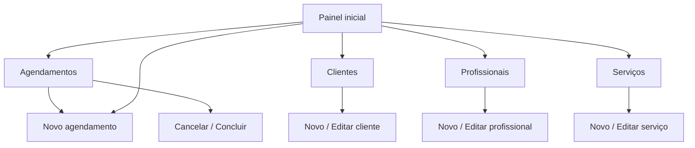

# 3. Interface Humano-Computador (IHC)

## 3.1 Princípios aplicados
| Princípio | Como foi aplicado |
|-----------|-------------------|
| Clara | Rótulos explícitos, campos obrigatórios marcados com `*`, textos de ajuda abaixo dos campos |
| Consistente | Mesmo menu em todas as telas; listas e formulários seguem o mesmo padrão; botões com cores fixas (verde = ação principal, vermelho = destrutiva) |
| Simples | Fluxo de agendamento em um único formulário; apenas os campos necessários |
| Controlada pelo usuário | Todas as ações partem de botões; nada é executado automaticamente |
| Direta | A escolha do serviço atualiza imediatamente a lista de profissionais; a data atualiza os horários |
| Recuperável/reversível | Confirmação antes de excluir/cancelar; agendamento pode ser cancelado; dados preenchidos permanecem após erro |
| Dá resposta | Mensagens de sucesso (verde) e erro (vermelho) após cada ação; indicador "Buscando horários…" |
| Esteticamente agradável | Paleta teal, espaçamento generoso, selos coloridos de situação |
| Acessível | `label` em todos os campos, foco visível, `aria-live` nas mensagens, contraste adequado, navegação por teclado |
| Responsiva | Layout adaptável a celulares (tabelas com rolagem horizontal) |

## 3.2 Mapa de navegação (mapa conceitual)


## 3.3 Telas
| Tela | Rota | Elementos principais |
|------|------|----------------------|
| Painel | `/` | Indicadores (hoje, próximos, clientes, profissionais, serviços), agenda do dia, botão "Novo agendamento" |
| Lista de clientes | `/clientes/` | Busca, tabela, Editar/Excluir |
| Formulário de cliente | `/clientes/novo` | Nome, e-mail, telefone (com máscara) |
| Lista de serviços | `/servicos/` | Tabela com duração, preço e situação |
| Formulário de serviço | `/servicos/novo` | Nome, descrição, duração, preço, ativo |
| Lista de profissionais | `/profissionais/` | Tabela com serviços vinculados |
| Formulário de profissional | `/profissionais/novo` | Nome, especialidade, serviços (checkboxes), ativo |
| Lista de agendamentos | `/agendamentos/` | Filtros (data, profissional, situação), Concluir/Cancelar |
| Novo agendamento | `/agendamentos/novo` | Cliente, serviço, profissional (dinâmico), data, horário (dinâmico), observação |
| Página não encontrada | qualquer rota inválida | Mensagem amigável e botão "Voltar ao início" |

## 3.4 Mensagens ao usuário
| Situação | Mensagem | Tipo |
|----------|----------|------|
| Cadastro concluído | "Cliente cadastrado com sucesso." | Sucesso |
| Nome curto | "O nome deve ter pelo menos 3 caracteres." | Erro |
| E-mail inválido | "Informe um e-mail válido (ex.: nome@dominio.com)." | Erro |
| E-mail repetido | "Já existe um cliente cadastrado com este e-mail." | Erro |
| Telefone inválido | "O telefone deve ter 10 ou 11 dígitos, com DDD." | Erro |
| Conflito de agenda | "O profissional já possui agendamento neste horário." | Erro |
| Data passada | "Não é possível agendar em data/hora que já passou." | Erro |
| Fora do expediente | "O atendimento deve ocorrer entre 08:00 e 18:00." | Erro |
| Exclusão bloqueada | "Este cliente possui agendamentos e não pode ser excluído." | Erro |
| Sem horários | "Não há horários livres nesta data. Tente outro dia ou profissional." | Informativo |
| Página inexistente | "Página não encontrada" | Erro 404 |

## 3.5 Protótipo (wireframe) do formulário de agendamento
```
+----------------------------------------------------------+
| 📅 Agenda Fácil   Início  Agendamentos  Clientes ...      |
+----------------------------------------------------------+
| Novo agendamento                                          |
| Cliente *       [ Selecione…                        ▼ ]   |
| Serviço *       [ Corte · 30 min · R$ 45,00         ▼ ]   |
| Profissional *  [ Bruno Lima                        ▼ ]   |
| Data *          [ 17/11/2026 ]  Horário * [ 10:00   ▼ ]   |
|                                  20 horário(s) livre(s).  |
| Observações     [                                      ]  |
| [ Confirmar agendamento ]  [ Cancelar ]                   |
+----------------------------------------------------------+
```
> O protótipo funcional está implementado em `app/views/templates/`. Inclua prints reais das telas na entrega.
