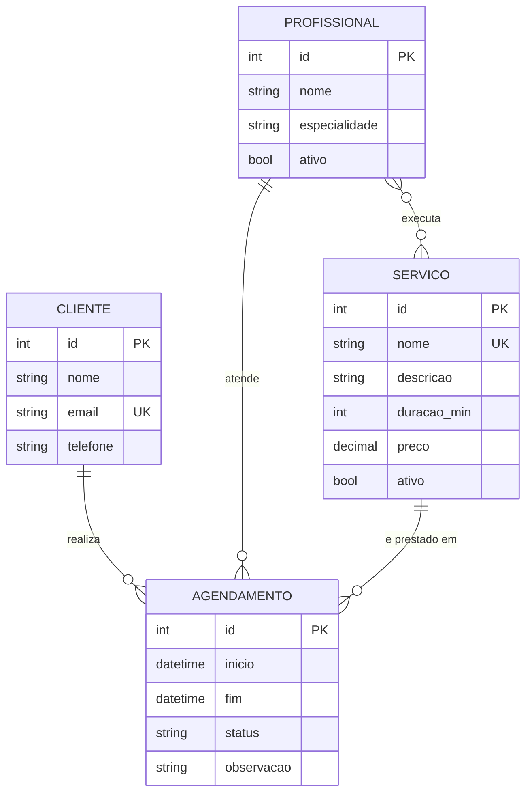

# 4. Projeto de Banco de Dados

## 4.1 Projeto conceitual (DER)

Cardinalidades:
- Um cliente realiza **0..N** agendamentos; cada agendamento pertence a **1** cliente.
- Um profissional atende **0..N** agendamentos; cada agendamento tem **1** profissional.
- Um serviço é prestado em **0..N** agendamentos; cada agendamento refere-se a **1** serviço.
- Profissional × Serviço é **N:N** (resolvido pela tabela associativa `profissional_servico`).

## 4.2 Projeto lógico (modelo relacional normalizado)
```
cliente (id PK, nome, email UNIQUE, telefone, criado_em)
servico (id PK, nome UNIQUE, descricao, duracao_min, preco, ativo)
profissional (id PK, nome, especialidade, ativo)
profissional_servico (profissional_id PK/FK, servico_id PK/FK)
agendamento (id PK, cliente_id FK, profissional_id FK, servico_id FK,
             inicio, fim, status, observacao, criado_em)
```
**Normalização**
- **1FN:** todos os atributos são atômicos (telefone armazenado só com dígitos; sem listas em coluna).
- **2FN:** todas as tabelas têm chave simples; em `profissional_servico` (chave composta) não há atributos além da própria chave.
- **3FN:** não há dependências transitivas — dados do cliente, do serviço e do profissional ficam em suas próprias tabelas e o agendamento apenas os referencia por chave estrangeira.
- **Decisão consciente:** `fim` é armazenado em `agendamento` (derivado de `inicio` + duração) para preservar o histórico caso a duração do serviço mude depois e para simplificar a detecção de conflitos.

## 4.3 Projeto físico
- **SGBD:** SQLite 3 — o mecanismo de banco de dados mais implantado do mundo, sem servidor, de manutenção simples e SQL padrão. O `schema.sql` é portável para PostgreSQL/MySQL com ajustes mínimos de tipos (ver tabela abaixo).
- **Script completo:** `database/schema.sql` (criado automaticamente na primeira execução).

| SQLite (usado) | PostgreSQL | MySQL |
|----------------|------------|-------|
| `INTEGER PRIMARY KEY AUTOINCREMENT` | `SERIAL` / `GENERATED ... AS IDENTITY` | `INT AUTO_INCREMENT` |
| `TEXT` (nomes) | `VARCHAR(n)` | `VARCHAR(n)` |
| `TEXT` (inicio/fim) | `TIMESTAMP` | `DATETIME` |
| `NUMERIC` (preco) | `NUMERIC(10,2)` | `DECIMAL(10,2)` |
| `INTEGER` 0/1 (ativo) | `BOOLEAN` | `TINYINT(1)` |

**Integridade**
| Mecanismo | Onde |
|-----------|------|
| `PRIMARY KEY` | todas as tabelas |
| `FOREIGN KEY ... ON DELETE RESTRICT` | `agendamento` → cliente, profissional, serviço (impede apagar quem tem histórico) |
| `FOREIGN KEY ... ON DELETE CASCADE` | `profissional_servico` (vínculo some junto com o profissional/serviço) |
| `UNIQUE` | `cliente.email`, `servico.nome` |
| `CHECK` | tamanho de nome, telefone (10/11), duração (5–480), preço ≥ 0, status válido, `fim > inicio` |
| Índices | `agendamento(profissional_id, inicio)`, `agendamento(cliente_id)`, `agendamento(status)` — aceleram a verificação de conflitos e os filtros |
